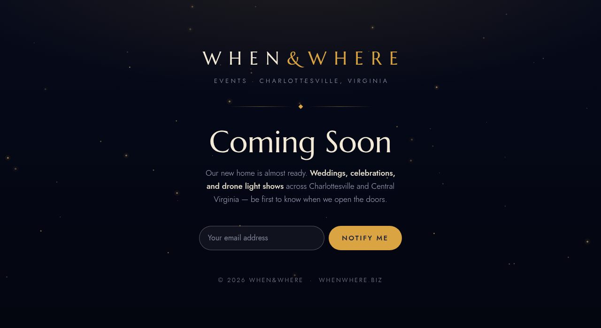

# WhenWhere.biz — Coming Soon

The coming-soon page for WhenWhere.biz: weddings, celebrations, and
drone light shows across Charlottesville and Central Virginia. It is
the placeholder that holds `whenwhere.biz` until the full site is
ready — one page, one job: collect emails for the launch list.

**Live:** <https://enonymous1.github.io/whenwhere-biz-coming-soon/>
— GitHub Pages, deployed from this repo (see [Deployment](#deployment)).

## What is on the page

- **One theme — Night & Gold** — night navy `#060a1a` + gold
  `#d9a441`, the same design system as the main site and the drone
  light shows page. The page follows the visitor's system: the night
  rendering in dark mode, warm ivory in light mode.
- **WHENWHERE wordmark, "Coming Soon" headline, one line** covering
  weddings, celebrations, and drone light shows in Charlottesville
  and Central Virginia.
- **A single email signup** — one field, one button ("Notify Me").
  Submitting POSTs the address to an Apps Script Web app that
  appends it to a private Google Sheet — the launch list (see
  [Launch-list setup](docs/LAUNCH-LIST-SETUP.md)). The page confirms
  with "You're on the list"; on a failed send it says so and keeps
  the form up so the visitor can retry.
- **A twinkling points-of-light canvas** behind the content — stars
  on the navy night, faint gold dust on the ivory light theme. It
  respects `prefers-reduced-motion` (a single still frame).
- **No email address is listed anywhere on the page.** The original
  Wix version signed people up by opening their mail app addressed
  to hello@whenwhere.biz; that mailto hand-off is gone — the form
  now records the address itself, and there is no "email us at"
  line to scrape or to answer by hand.

## Screenshot

Captured from the page at 1280×700 in dark mode (the page follows
the OS — the light rendering is the same layout in warm ivory).
Serve the folder over HTTP first so the fonts load.



## Preview

`index.html` is the whole page — open it in a browser, or serve the
folder so paths resolve exactly as they will on Pages:

```bash
python3 -m http.server 8000
# open http://localhost:8000
```

Note: with `LAUNCH_LIST_ENDPOINT` still blank, the form tells
visitors signups aren't open yet instead of silently dropping their
email. Wire the endpoint first (below), then push. The URL goes in
two places that must stay in sync: `LAUNCH_LIST_ENDPOINT` in
`WHENWHERE_CONFIG` (the JavaScript path) and the form's `action`
(the no-JavaScript fallback, which posts straight to the same
endpoint). A signup that takes longer than 15 seconds reports
"That’s taking too long" and can be retried — the server dedups,
so a retry never creates a second row.

## Launch-list setup

Full step-by-step instructions — private Sheet, Apps Script
deployment, testing, and troubleshooting — are in
[docs/LAUNCH-LIST-SETUP.md](docs/LAUNCH-LIST-SETUP.md). The short
version: create a new private Google Sheet, paste
`docs/apps-script/Code.gs` into its Apps Script editor, deploy it as
a Web app (Execute as: Me, Who has access: Anyone), paste the Web
app URL as `LAUNCH_LIST_ENDPOINT` in `WHENWHERE_CONFIG` in
`index.html`, push once. After that, every signup lands as a row in
the Sheet — `Submitted | Email`, deduped by address — and the list
is yours to export when launch time comes.

## Deployment

Hosted on GitHub Pages via GitHub Actions — free, fast, versioned in
git, and no backend server needed. The workflow
(`.github/workflows/pages.yml`) deploys the page on every push to
`main`. There is no build step: what is committed is what goes live.

**One-time setup:**

1. Create an EMPTY public repo, e.g.
   `enonymous1/whenwhere-biz-coming-soon`.
2. Upload this folder's contents (including `.github/` and `docs/`)
   to its root.
3. Repo → **Settings → Pages → Build and deployment → Source: GitHub
   Actions** → Save. (Not "Deploy from a branch".)
4. Push to `main`. Watch the run under the repo's **Actions** tab;
   it takes ~1–2 minutes. The live URL is
   `https://enonymous1.github.io/whenwhere-biz-coming-soon/` — that
   is the link to share for the demo.

**Updating the page:** edit `index.html` and push. Copy changes do
not need a redeploy of anything else — the page is static, and the
launch list lives in the Sheet, not the repo.

## Custom domain

To serve this page at `whenwhere.biz` itself (instead of the
github.io URL), see
[docs/CUSTOM-DOMAIN.md](docs/CUSTOM-DOMAIN.md). The short version:
the repo already carries a `CNAME` file with `whenwhere.biz`;
point the domain's DNS at GitHub's Pages IPs and turn on Enforce
HTTPS. When the full site is ready, the custom domain moves to the
main-site repo and the DNS stays the same.

When the full site is ready, this page is the one that comes down —
`whenwhere.biz` points at the main site instead.

## Project structure

```text
whenwhere-biz-coming-soon/
├── .github/
│   └── workflows/
│       └── pages.yml           # deploy on push to main
├── docs/
│   ├── LAUNCH-LIST-SETUP.md    # private Sheet + Apps Script setup, testing, troubleshooting
│   ├── CUSTOM-DOMAIN.md        # point whenwhere.biz at this page (DNS + HTTPS)
│   ├── screenshots/
│   │   └── hero.png            # README hero shot (1280×900, dark mode)
│   └── apps-script/
│       └── Code.gs             # Apps Script doPost for the launch-list Sheet
├── index.html                  # the page
├── README.md
└── LICENSE                     # © 2026 WhenWhere.biz, all rights reserved
```

## License

© 2026 WhenWhere.biz — All rights reserved. See `LICENSE`.
