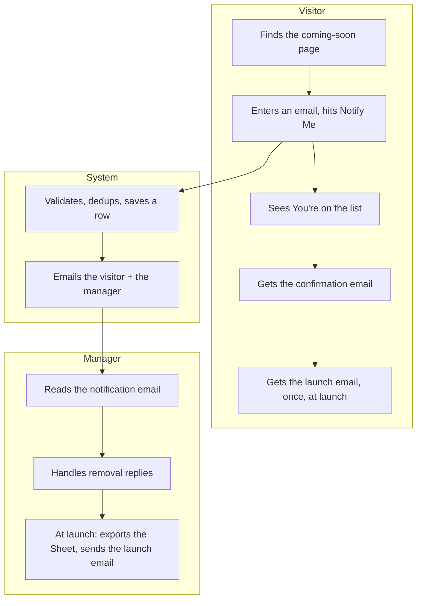
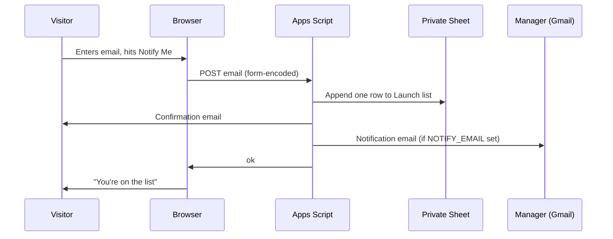

# WhenWhere.biz — Launch-List Pipeline & Workflow

**What this is:** the journey of one signup on the coming-soon page,
from a visitor finding the page to the launch email going out, told
from both sides — what the **visitor** sees and does, and what the
**manager** (Justin) sees and does.

**Scope:** the coming-soon page only (the single email field at
`whenwhere.biz` until the full site is ready). The main site and the
drone site have their own pipeline docs — the main site's is at
`whenwhere-biz-main-site/docs/INQUIRY-PIPELINE.md`, and it covers
inquiries, not signups; nothing in this document applies to those
forms.

**What it is not:** a setup guide. Creating the Sheet, pasting the
script, and deploying it is in `docs/LAUNCH-LIST-SETUP.md`. This
document assumes that setup is done and describes the pipeline as
it runs day to day — and on launch day.

> The diagrams below are Mermaid. They render as charts on GitHub; in a
> plain text editor they read as the code blocks they are.

---

## The pipeline at a glance

---

## Stage 0 — Setup (manager only, one time)

Before any of this works, the manager has already done the following
(once). The visitor never sees any of it.

| Manager does | Where |
|---|---|
| Creates the **private launch-list Sheet** — e.g. `WhenWhere — Launch list`. Never published to web, Share on Restricted. It holds people's email addresses. | Google Sheets |
| Pastes `docs/apps-script/Code.gs` into the Sheet's Apps Script editor, leaves `SEND_CONFIRMATION` on, optionally sets `NOTIFY_EMAIL` to his personal Gmail, and deploys it as a web app (Execute as: Me, Who has access: Anyone). | Apps Script |
| Puts the web app URL in the page as `LAUNCH_LIST_ENDPOINT` (in `WHENWHERE_CONFIG`, in two places — the config and the form's `action` — that must stay in sync). | `index.html` |
| Points `whenwhere.biz` at the page and turns on Enforce HTTPS once DNS resolves. | `docs/CUSTOM-DOMAIN.md` |

---

## Stage 1 — Sign up: the form

### Visitor

- Lands on the coming-soon page, reads the wordmark, the headline,
  and the one-line pitch.
- Enters an email in the single field and hits **Notify Me**.
- If the address is malformed, the form flags it and nothing is sent.
- Sees a **thanks panel**: "You're on the list" — "We'll email you
  the moment we launch — a confirmation first, then one email when
  the doors open. That's all."
- With JavaScript off, the form still submits directly to the Apps
  Script endpoint and the browser shows the plain-text answer.

### What the system does (automatic)

1. Validates the address in the browser (same check the script runs
   again server-side), then POSTs it to the Apps Script endpoint.
   The page waits up to 15 seconds for the answer.
2. The script takes a script lock (up to 10 seconds), then validates
   again: non-empty, at most 254 characters, no formula-leading
   character (`=`, `+`, `-`, `@`), and the same email shape.
3. The script dedups case-insensitively against column B (Email).
   A repeat address returns `ok` with no second row and no second
   email — so a visitor retrying after a timeout, or double-clicking
   Submit, can never create a duplicate or a second confirmation.
4. The script appends one row to the `Launch list` tab —
   2 columns: `Submitted | Email`. It writes the header row itself
   when the tab is empty, and inserts headers above headerless data
   instead of treating the first data row as the header.
5. The script sends the two emails (Stage 2), then answers `ok`,
   and the page shows the thanks panel.
6. Anything else — an invalid address, a busy lock, a script error —
   gets a generic `error: …` body, and the page shows "Something went
   wrong — please try again in a moment" with the form still up.
   Apps Script always answers HTTP 200, even on rejection, so the
   page reads the body, not the status.

### Manager

- Does nothing at this stage — the row and the emails happen on
  their own.

---

## Stage 2 — The two emails

Both emails go out via MailApp, which means both come **from the
Gmail account the script runs as** — the manager's personal Gmail,
for now. Sending from `hello@whenwhere.biz` needs a mailbox for that
address first (there is none yet), then a verified Gmail "Send mail
as" alias for it, and a switch in `Code.gs` from `MailApp` to
`GmailApp.sendEmail({ from: ... })`.

### The confirmation (to the visitor)

- Subject: `You're on the WhenWhere launch list`.
- States the honest total — this confirmation plus one launch email,
  two emails in all: "We'll email you when we launch — one more
  email, and that's everything."
- Names the address it was sent to, and routes both cases to one
  reply: "If that wasn't you, or you'd like to be removed, just
  reply to this email — we'll take you off the list." It deliberately
  does **not** tell a mistaken recipient to ignore it — an ignored
  address would still get the launch email.
- Carries no running total and no Sheet link (those are owner-only),
  and a gold "Visit WhenWhere.biz" button.
- Sent first, before the notification below: the page promises the
  visitor an email, so when the day's mail quota is nearly out, the
  visitor's email gets the remaining sends first — the manager
  always has the Sheet as the record.

### The notification (to the manager)

- Only sent when `NOTIFY_EMAIL` is set; blank means the Sheet is the
  only record.
- Subject: `New WhenWhere launch-list signup (#N)`, where N is the
  running total on the list, exact under the script lock.
- Lists the new address, the total, the submitted time, and ends
  with a link back to the private Sheet.
- Both emails are sent as plain text plus a lightly styled HTML
  version (inline styles only — Gmail strips `<style>` blocks,
  webfonts, and images; navy header, gold accent, no logo, no
  tracking pixel).

### What the system does

- Both sends are best-effort and logged, never fatal: the row is
  already saved, so a mail failure (daily quota, transient error)
  is written to the Apps Script **Executions** log and the signup
  still returns `ok`. A failed send never makes the page report a
  failure for a signup that landed.
- **Quota:** Apps Script counts recipients, not emails — a consumer
  Gmail account gets 100 recipients a day, so with both emails on,
  one signup costs two recipients and the day's budget covers 50
  signups. With the notification off, it covers 100.

### Visitor

- Gets the confirmation in their inbox — the first of the two
  emails. The second arrives only at launch (Stage 4).

---

## Stage 3 — Living with the list

### Manager

- **When a notification email arrives:** read it (or click its Sheet
  link). Nothing to do unless the address looks wrong — the row is
  already in the Sheet.
- **When a removal reply arrives:** a subscriber replying "take me
  off", or someone saying "this signup wasn't mine", lands in the
  manager's Gmail. Removing them is deleting their row from the
  `Launch list` tab — that is the unsubscribe until the launch mail
  tool takes over. There is no unsubscribe link in the confirmation
  email, by design: the list is a Sheet, not a mailing tool.
- **When a signup looks like spam:** anyone with the endpoint URL can
  POST, and there is no CAPTCHA or rate limiting — Google's quotas
  are the only throttle. If spam ever lands, delete the rows; the
  fix then is a token or honeypot in the form, not a secret URL.
- **When the day's quota runs out:** signups still save to the Sheet
  — only the emails stop, and the failures are logged. The next
  day's signups send normally. If the list ever grows past ~50
  signups a day, the notification is the first thing to turn off
  (`NOTIFY_EMAIL` blank), since the Sheet is the record.

### What the system does

- Nothing between signups. The list sits in the Sheet; nothing
  watches it, reminds anyone, or sends anything unprompted.

---

## Stage 4 — Launch

### Manager

1. **Export the Sheet** (File → Download → CSV). The list is a plain
   two-column CSV — `Submitted | Email` — so it imports anywhere.
2. **Pick the sending tool** for the launch email: personal Gmail
   for a small list, or a mailing tool (Buttondown, Mailchimp,
   ConvertKit) if the list is big enough to want unsubscribes and
   delivery tracking. Decide when the launch date is real; there is
   nothing to set up now.
3. **Send the one launch email** from that tool. It carries the
   tool's own unsubscribe link — that replaces the reply-to-remove
   arrangement from Stage 3.
4. **After launch:** the coming-soon page comes down and
   `whenwhere.biz` points at the main site instead. The Sheet stays
   as the record of who asked to hear about the launch; it is not
   used for anything else unless those people opt in again.

### Visitor

- Gets the launch email — the second and last email from the list.
  Unsubscribing from it uses the mail tool's link, not a reply.

### What the system does

- Nothing. The launch email is sent by the manager from the tool
  he picks, not by this pipeline — the Apps Script only ever sends
  the confirmation and the notification.

---

## What is automatic, and what is manual

| Step | Automatic | Manual (manager) |
|---|---|---|
| Form validation | Browser + script (same check both sides) | — |
| Row saved to `Launch list` | Script appends it + writes the header once | Inserting headers by hand is not needed — the script inserts them |
| Dedup | Case-insensitive scan of column B under a script lock | — |
| Visitor confirmed | Confirmation email (plain text + styled HTML) | — |
| Manager notified | Email to `NOTIFY_EMAIL` on every new signup, with a Sheet link | Reading it |
| Removal | — | Delete the row when a removal reply arrives |
| Quota exhaustion | Signups still save; failed sends are logged | Turning the notification off if the list outgrows the quota |
| Launch email | — | Export the CSV, pick the tool, send it |
| After launch | — | Point the domain at the main site; keep the Sheet as the record |

---

## The manager's routine

**When a notification email arrives:**
1. Read the email (or click its Sheet link).
2. Nothing to do — the row is already saved.

**When a removal reply arrives:**
1. Open the `Launch list` tab.
2. Delete that address's row.
3. Reply to confirm, if you like — the removal itself is the delete.

**Weekly (or when the list looks busy):**
1. Skim the `Launch list` tab for anything odd (spam rows, duplicates
   the dedup should have caught).
2. Check the Apps Script **Executions** log for failed sends — a run
   of failures means the quota is being hit, not that signups are
   failing.

**At launch:**
1. Export the Sheet to CSV.
2. Pick the sending tool and import the CSV.
3. Send the one launch email.
4. Point `whenwhere.biz` at the main site.

---

## Gaps & decisions (what the pipeline does not do yet)

These are things the system does **not** do today. Each is a decision,
not a bug — but they are the places where the pipeline leans on the
manager's memory.

1. **No branded From address.** Both emails come from the manager's
   personal Gmail. `hello@whenwhere.biz` needs a mailbox first, then
   a Gmail alias, then a `GmailApp` switch in the script.
2. **No unsubscribe link in the confirmation.** Removal is a reply
   plus a manual row delete. The launch email's mail tool provides
   the real unsubscribe link.
3. **No double opt-in.** A signup is one POST; anyone can enter
   someone else's address, and that person gets the confirmation.
   The confirmation's reply line is the mitigation, not a fix — a
   confirm-your-address step would be a second round-trip through
   the form and the Sheet.
4. **No CAPTCHA or rate limiting.** Anyone with the endpoint URL can
   POST. Google's quotas are the only throttle, and spam rows are
   deleted by hand.
5. **No status column.** The `Launch list` tab records what the
   visitor submitted — timestamp and address. It does not track
   anything else (no removal requests, no launch-email opens);
   removal is a delete, not a status.
6. **One notification address.** `NOTIFY_EMAIL` is a single personal
   Gmail. A second recipient would mean a second address in the
   script.
7. **The daily quota is shared with everything else the account
   sends through Apps Script.** 100 recipients a day is the whole
   budget for this script and any other script running as the same
   account — 50 signups a day with both emails on.

---

## One-page summary

| Stage | Visitor | System (automatic) | Manager |
|---|---|---|---|
| Sign up | Enters an email, hits Notify Me | Validates, dedups, saves a row | — |
| The two emails | Gets the confirmation | Sends confirmation, then notification | Reads the notification |
| Living with the list | — | — | Deletes rows on removal replies; watches the quota |
| Launch | Gets the launch email | — | Exports the CSV, picks the tool, sends it, repoints the domain |
